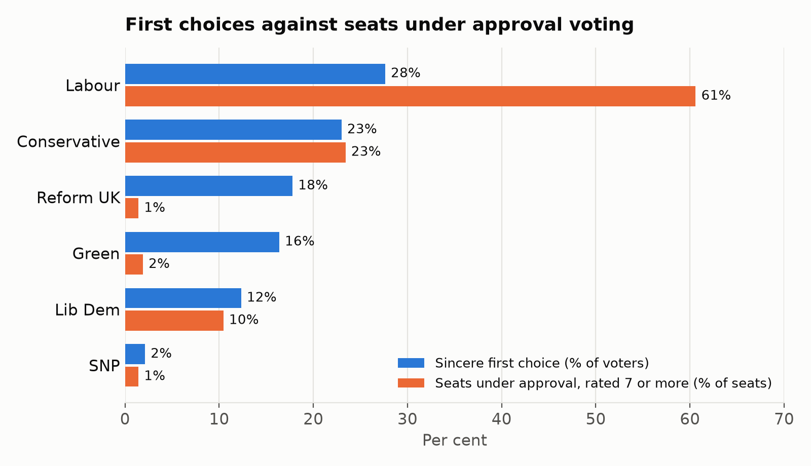

I've spent a long time arguing for approval voting, and the evidence keeps backing it up. In [St. Louis](/democracy/2025/08/29/st-louis-approval-voting.html), a third of voters used it to support more than one candidate, and it ended the vote splitting that handed the 2017 primary to a candidate most voters didn't want.

So here's a question I get a lot in the UK: if Westminster kept its 650 constituencies and just swapped the "Choose One" ballot for an approval ballot, would Parliament be fair?

The short answer is no. Approval voting fixes the ballot. It doesn't fix the seat count. This post puts a number on how big that gap is, using real British voters' preferences rather than guesses.

## Why one winner per seat can't be proportional

Under approval voting, you mark every candidate you're happy with, and the candidate with the most marks wins. That's a better way to pick *one* winner. It finds the candidate acceptable to the most people, instead of the one with the biggest bloc.

But each constituency still elects one MP, and that MP takes 100% of the seat. Imagine 60% of voters in every constituency approve only Party A, and the other 40% approve only Party B. Party A wins all 650 seats. Nothing in the count shares seats out by support, so the distortions of winner-takes-all are still there. They just land on different parties.

## Measuring "unfair": the Gallagher index

The standard measure of how far seats stray from votes is the **Gallagher index**. For each party, take its share of votes minus its share of seats, in percentage points. Square each difference, add them up, halve the total, and take the square root.

> Gallagher index = √( ½ × Σ (vote share − seat share)² )

A score of 0 means seats exactly match votes. Proportional systems usually score between 1 and 5. The UK's 2024 general election scored about 24, which the Electoral Reform Society [called the most disproportional in British history](https://www.politics.co.uk/news/2024/12/10/2024-general-election-was-historically-disproportional-and-volatile-new-report-says/). The previous record was 20.6 in 1983.

## Why you can't just re-count the 2024 votes

My first attempt at this took the 2024 results and layered approval assumptions on top. That's wrong, for two reasons.

1. **People would vote differently.** In 2024, millions of people voted tactically for a candidate who could beat the one they disliked most, not for their favourite. Those votes were cast under "Choose One" incentives. They aren't approval ballots.
2. **"Bullet voting" isn't First Past the Post.** Under approval, a voter who marks one candidate marks their *favourite*. Under First Past the Post, many people never vote for their favourite at all. So even the most minimal approval election wouldn't reproduce 2024.

To do this properly, you need what people actually think of each party, measured separately from how they voted.

## The data: the 2024 British Election Study

The [British Election Study](https://www.britishelectionstudy.com/) surveys around 30,000 people per wave. Its post-election wave, fielded in July 2024, asked everyone how much they like each party on a scale from 0 ("strongly dislike") to 10 ("strongly like"). That covers the Conservatives, Labour, the Liberal Democrats, Reform UK, the Greens, the SNP and Plaid Cymru.

We used 26,655 weighted respondents from Great Britain, and built the estimate in four steps:

1. **Approval sets come from likes, not votes.** A respondent approves every party they rate at or above a cut-off. Their sincere favourite is the party they rate highest. Because nobody knows exactly how British voters would use an approval ballot, we ran several cut-offs, from "favourite only" to "anything within two points of your favourite".
2. **Learn the patterns by region.** For each region and each 2024 vote choice, we estimated what share of those voters approve each party. For example: what share of Labour voters in the North West also approve the Greens?
3. **Apply them to every constituency.** We applied those rates to each of the 632 GB constituencies' actual 2024 vote mix, counted the approvals for each party standing there, and gave the seat to the most-approved party.
4. **Score against sincere first choices.** Each scenario's Gallagher index is measured against each party's share of sincere first choices, not against the tactical 2024 vote.

## The results

| Scenario | Lab | Con | Reform | Lib Dem | Green | SNP | Gallagher |
|---|---|---|---|---|---|---|---|
| Sincere first choice (% of voters) | 27.6% | 23.0% | 17.8% | 12.3% | 16.4% | 2.1% | — |
| 2024 actual seats (First Past the Post) | 409 | 121 | 5 | 72 | 4 | 9 | 31.1 |
| Approval: favourite only | 356 | 191 | 17 | 47 | 8 | 9 | 26.0 |
| Approval: rated 8 or more | 362 | 180 | 14 | 52 | 10 | 9 | 26.3 |
| Approval: rated 7 or more | 383 | 148 | 9 | 66 | 12 | 9 | 28.0 |
| Approval: rated 6 or more | 417 | 113 | 6 | 74 | 11 | 6 | 31.6 |
| Approval: within 2 of own top | 443 | 68 | 7 | 84 | 22 | 3 | 34.6 |
| Proportional allocation | 175 | 145 | 112 | 78 | 104 | 13 | 0.1 |

_Seats are out of 632 GB constituencies. Northern Ireland isn't in the British Election Study. Against the actual 2024 vote, rather than sincere first choices, the 2024 result scores 24.2._

## What the numbers say

**Approval voting in single-member seats is about as disproportional as what we have now.** Every approval scenario scores between 26 and 35. The 2024 result scores 31 against the same benchmark, and a proportional count scores about 0. The ballot changes who wins. The single winner per seat is what keeps the seat shares lopsided.

**The more generously people approve, the worse it gets.** With narrow approval, the Conservatives do better than they did in 2024. With broad approval, Labour wins up to 443 seats on 28% of first choices. That's because Labour is acceptable to most Green and Lib Dem voters, so it tops the approval count almost everywhere. This is approval doing exactly what it's designed to do: rewarding the broadly acceptable candidate. In a single-winner race, that's a feature. Across 632 single-winner races, it compounds into a landslide.

**Reform UK and the Greens are squeezed out.** Between them they're the sincere first choice of about 34% of voters, but they win only 17 to 29 seats between them.

The two parties fail for different reasons. Reform UK is polarising: lots of people rank it first, and few others rate it highly. The Greens are well liked, but the Green-friendly voters in almost every seat like Labour too, so Labour gets there first. Either way, being many people's favourite without being most people's acceptable choice gets you almost nothing in a winner-takes-all count.

**Sincere voting alone reshuffles Parliament.** Even the "favourite only" scenario, where nobody votes tactically, moves Labour from 409 seats to 356 and the Conservatives from 121 to 191. Tactical voting did a lot of work in 2024. A better ballot removes it, but that doesn't make the result proportional.

## What this means for reform

None of this is a knock on approval voting. It's a reminder to use the right tool for the job.

For a **single office**, like a mayor, a president or a party leader, approval voting is excellent. It picks the candidate the most people can live with, and it ends vote splitting. St. Louis is the proof.

A **Parliament** has a different job. It's meant to represent everyone, so it needs a count that shares seats out in proportion to support. The good news is that you don't have to give up the simple approval ballot to get there:

- **[Proportional Approval](https://proportional.uk/proportional-approval)** elects a team of MPs from a larger area. You still mark everyone you support, and the count gives each group of voters its fair share of the seats.
- **[The Additional Member System with approval](https://proportional.uk/ams-plus)** keeps one local MP, elected by approval, and adds top-up MPs so the overall result matches the party vote.

Both keep the ballot as simple as today's. They just stop the seat count from being winner-takes-all.

## Caveats

- **How British voters would approve is unknown.** That's why we ran a range of cut-offs rather than one number. Real approval behaviour could also be more strategic than any fixed cut-off.
- **Local effects are simplified.** Constituencies differ only through their 2024 vote mix and their region. Candidates, incumbency and local campaigns aren't modelled.
- **Independents can't win in the model,** because the survey doesn't ask about individual candidates.
- **The Greens' sincere share is high.** At 16.4%, it's more than double their 2024 vote. That comes straight from the weighted survey, where many Labour and Lib Dem voters rated the Greens above the party they voted for. But it's the number most worth a second look.
- **This is Great Britain only.** Northern Ireland isn't in the British Election Study.

## Method and code

The analysis script and its output are here: [approval_estimate.py](/components/data/posts/2026-11-10-approval-voting-proportionality/approval_estimate.py) and [results.json](/components/data/posts/2026-11-10-approval-voting-proportionality/results.json).

It needs three inputs:

1. The British Election Study Internet Panel, 2024 release, waves 1–31 (`BES2024_W31_Panel_v31.05.sav`), which you can download for free from the [British Election Study](https://www.britishelectionstudy.com/).
2. The 2024 constituency results: [ge2024-constituency-results.json](https://github.com/fsargent/proportional.uk/blob/main/src/lib/data/ge2024-constituency-results.json), compiled from Open Innovations' results files.
3. The constituency-to-region lookup: [uk-westminster-hexes.json](https://github.com/fsargent/proportional.uk/blob/main/src/lib/data/uk-westminster-hexes.json).

If you can improve on the method, I'd love to hear from you.

Changing how we vote is the foundation for every other democratic improvement, but only if we pick a system that does the job we need. If you want a Parliament that looks like the country, support the campaigners working for it: [Make Votes Matter](https://makevotesmatter.org.uk/) in the UK, and the [Center for Election Science](https://electionscience.org/) for better voting methods everywhere.
