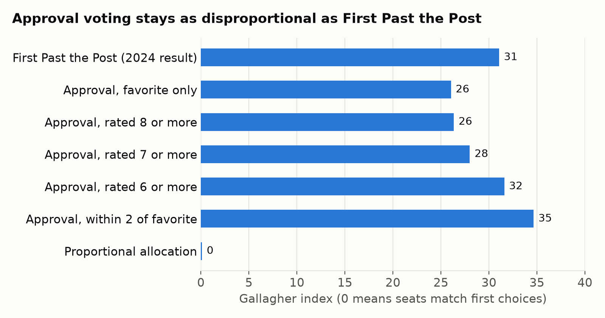
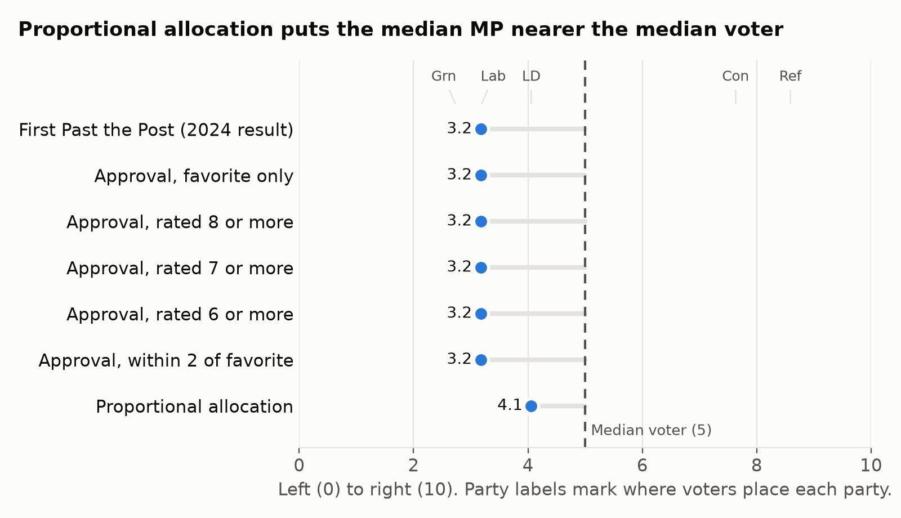

On 2024 British Election Study data, proportional allocation puts the median MP 0.9 points from the median voter. The scale runs from 0 (left) to 10 (right). Single-member approval voting puts the median MP 1.8 points away, the same gap as First Past the Post. Approval voting wins a different test. The average voter likes its Parliament more.

I have argued for approval voting for years. In [St. Louis](/democracy/2025/08/29/st-louis-approval-voting.html), a third of voters used it to back more than one candidate, and it ended vote splitting in the mayoral primary. Approval voting picks the candidate whom the most voters accept. Its supporters, me included, often say that the property makes for a centrist legislature. The British data lets us test the claim for Westminster.

## The test

Suppose that Westminster keeps its 650 constituencies and swaps the single-mark ballot for an approval ballot. Each voter marks every candidate they accept, and the candidate with the most marks wins the seat. I compare the result with First Past the Post, and with proportional allocation of the same 632 seats in Great Britain.

I use three measures:

1. Proportionality, by the Gallagher index. For each party, subtract its seat share from its first-choice share. Square the gaps, add them, halve the sum, and take the square root. A score of 0 means that seats match first choices.
2. Centrism, by the gap between the median MP and the median voter. A second measure, the mirror distance, gives the average distance that voters must move along the scale to match the spread of MPs.
3. Satisfaction, by the like-score that the average voter gives the parties in Parliament.

Proportional systems score between 1 and 5 on the Gallagher index. The 2024 general election scored about 24, which the Electoral Reform Society [called the most disproportional in British history](https://www.politics.co.uk/news/2024/12/10/2024-general-election-was-historically-disproportional-and-volatile-new-report-says/). The previous record was 20.6, in 1983.

## The data

The [British Election Study](https://www.britishelectionstudy.com/) surveyed 26,655 people in Great Britain after the 2024 election. Each person rated each party from 0 (strongly dislike) to 10 (strongly like), and placed themselves on the left-right scale. In the survey before the election, people also placed each party on the same scale.

The 2024 votes cannot stand in for approval ballots. Millions of people voted tactically in 2024, against their favorite. Under approval voting, a voter who marks one candidate marks their favorite. So the model builds approval ballots from like-scores, not from votes. The model works in four steps:

1. A voter approves each party that they rate at or above a cut-off. Five cut-offs cover the range, from the favorite only to every party within 2 points of the favorite. A voter's first choice is the party that they rate highest.
2. For each region and each 2024 vote, the model estimates the share of voters who approve each party.
3. The model applies the shares to the 2024 vote count of each constituency. The most-approved party wins the seat.
4. Proportional allocation shares all 632 seats by first choices, with the Sainte-Laguë divisor method.

## Approval voting does not fix proportionality

<figure class="post-chart">
  <figcaption>Approval voting stays as disproportional as First Past the Post</figcaption>
  

</figure>

Every approval scenario scores between 26 and 35 on the Gallagher index. First Past the Post scores 31 against first choices, and proportional allocation scores 0. Against the 2024 votes, the 2024 result scores 24. Against first choices it scores 31, because tactical votes hid support for smaller parties.

One winner per seat causes the gap, not the ballot. Approval voting changes who wins each seat, but the winner still takes the whole seat.

| Scenario | Labour | Conservative | Reform UK | Liberal Democrat | Green | SNP | Gallagher index |
|---|---|---|---|---|---|---|---|
| First choice, share of voters | 27.6% | 23.0% | 17.8% | 12.3% | 16.4% | 2.1% | |
| First Past the Post (2024 result) | 409 | 121 | 5 | 72 | 4 | 9 | 31 |
| Approval, favorite only | 356 | 191 | 17 | 47 | 8 | 9 | 26 |
| Approval, rated 8 or more | 362 | 180 | 14 | 52 | 10 | 9 | 26 |
| Approval, rated 7 or more | 383 | 148 | 9 | 66 | 12 | 9 | 28 |
| Approval, rated 6 or more | 417 | 113 | 6 | 74 | 11 | 6 | 32 |
| Approval, within 2 of favorite | 443 | 68 | 7 | 84 | 22 | 3 | 35 |
| Proportional allocation | 175 | 145 | 112 | 78 | 104 | 13 | 0 |

Reform UK and the Greens are the first choice of 34% of voters. They win 17 to 29 seats between them under approval voting. Reform UK is the first choice of 17.8% of voters, but 48% of voters rate it 0. The Greens are the first choice of 16.4% of voters, but they top the approval count in only 4 to 22 seats.

## Approval voting does not center Parliament

<figure class="post-chart">
  <figcaption>Proportional allocation puts the median MP nearer the median voter</figcaption>
  

</figure>

Labour wins a majority in every single-member scenario. The median MP is therefore a Labour MP, at 3.2 on the scale. The median voter sits at 5, so the gap is 1.8 points under First Past the Post and under every approval cut-off.

Proportional allocation gives no party a majority. The median MP is a Liberal Democrat, at 4.1, and the gap falls to 0.9 points. The median voter sits between the Liberal Democrats at 4.1 and the Conservatives at 7.6. No party stands in the gap.

Approval voting makes each constituency pick its most acceptable party. In 2024, Labour was the most acceptable party in most constituencies. The local choices add up to one party's majority, and the center of Parliament becomes the center of the party.

| Scenario | Median MP | Gap to median voter | Spread of MPs | Mirror distance | Like-score for Parliament |
|---|---|---|---|---|---|
| Voters | 5.0 | | 2.2 | | |
| First Past the Post (2024 result) | 3.2 | 1.8 | 1.8 | 1.3 | 4.0 |
| Approval, favorite only | 3.2 | 1.8 | 2.1 | 1.1 | 3.9 |
| Approval, rated 8 or more | 3.2 | 1.8 | 2.1 | 1.2 | 3.9 |
| Approval, rated 7 or more | 3.2 | 1.8 | 1.9 | 1.2 | 4.0 |
| Approval, rated 6 or more | 3.2 | 1.8 | 1.7 | 1.4 | 4.1 |
| Approval, within 2 of favorite | 3.2 | 1.8 | 1.5 | 1.6 | 4.2 |
| Proportional allocation | 4.1 | 0.9 | 2.4 | 1.1 | 3.7 |

The spread is the standard deviation of positions on the scale. Proportional allocation spreads MPs by 2.4, against 2.2 for voters. Generous approval squeezes MPs to 1.5, around Labour. The mirror distance agrees. Proportional allocation scores 1.1, and approval voting scores between 1.1 and 1.6.

## Approval voting wins on dislike

The average voter gives Parliament a like-score of 4.2 under generous approval voting, against 3.7 under proportional allocation. Proportional allocation gives Reform UK 112 seats, and 64% of voters rate Reform UK 3 or below. Approval voting keeps out a party that most voters dislike.

The difference is a real trade-off. Proportional representation seats the parties that most voters dislike, in proportion to the voters who support them. Approval voting seats the parties that most voters accept, and gives the rest almost nothing.

Approval voting barely changes how voters rate their own MP. The like-score for the party of the local MP moves from 4.5 under First Past the Post to between 4.5 and 4.6 under approval voting. Under proportional allocation, the average voter's best-rated party in Parliament scores 7.5.

## What the model cannot show

The model works with parties, but approval voting elects people. Two Labour candidates and a Labour-leaning independent can all stand in one constituency without a split vote. A Labour MP who wins a marginal seat by approval needs Conservative and Liberal Democrat approvals. The MP can sit nearer the center than the party.

Party-level survey data cannot measure the effect. To match proportional allocation, Labour MPs elected by approval must sit, on average, at the Liberal Democrat position.

The model has four other limits:

1. Nobody knows how British voters will use an approval ballot, so the model uses a range of cut-offs.
2. Parties will move under a new system. The model holds the 2024 parties and their positions fixed.
3. The model has no independents and no Northern Ireland, because the survey covers only parties in Great Britain.
4. The Greens' first-choice share is 16.4%, more than double their 2024 vote of 6.9%.

## Use each method for its job

Approval voting is the best method I know for a single office, such as a mayor or a party leader. It picks the candidate whom the most voters accept. A Parliament has a different job: to represent the whole electorate, its center and its spread. On the 2024 data, proportional representation does the job better, and it puts the median MP nearer the median voter.

Proportional representation does not need a complicated ballot. [Proportional Approval](https://proportional.uk/proportional-approval) elects a team of MPs from a larger area, and each voter marks every candidate they support. [The Additional Member System with approval](https://proportional.uk/ams-plus) keeps one local MP, elected by approval, and adds top-up MPs to match the party vote.

[Make Votes Matter](https://makevotesmatter.org.uk/) campaigns for proportional representation at Westminster. The [Center for Election Science](https://electionscience.org/) campaigns for approval voting. Both deserve your support.

## Method and code

The code and its output:

1. [approval_estimate.py](/components/data/posts/2026-11-10-approval-voting-proportionality/approval_estimate.py) builds the approval ballots and counts the seats. Its output is [results.json](/components/data/posts/2026-11-10-approval-voting-proportionality/results.json).
2. [congruence.py](/components/data/posts/2026-11-10-approval-voting-proportionality/congruence.py) measures the median MP, the spread, the mirror distance, and the like-scores. Its output is [congruence.json](/components/data/posts/2026-11-10-approval-voting-proportionality/congruence.json).
3. [charts.py](/components/data/posts/2026-11-10-approval-voting-proportionality/charts.py) draws the two charts.

The code needs three inputs:

1. The British Election Study Internet Panel, 2024 release, waves 1 to 31 (`BES2024_W31_Panel_v31.05.sav`). The file is a free download from the [British Election Study](https://www.britishelectionstudy.com/).
2. The 2024 constituency results, [ge2024-constituency-results.json](https://github.com/fsargent/proportional.uk/blob/main/src/lib/data/ge2024-constituency-results.json), compiled from the Open Innovations results files.
3. The region of each constituency, [uk-westminster-hexes.json](https://github.com/fsargent/proportional.uk/blob/main/src/lib/data/uk-westminster-hexes.json).

If you can improve the method, please write to me.

