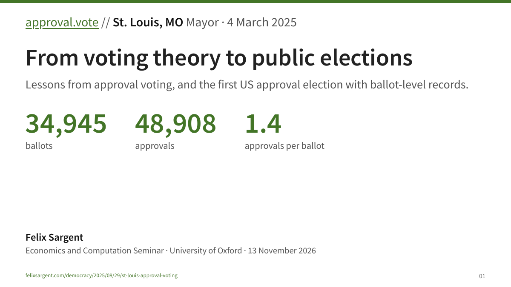

On 13 November I gave a talk at the University of Oxford's [Economics and Computation Seminar](https://www.cs.ox.ac.uk/seminars/2871.html), hosted by Markus Brill. The question was simple to state: what does it take to move a voting method from a research paper onto a public ballot, and what can we learn once it gets there?

  <object data="/components/slides/2026-11-13-voting-theory-to-public-elections.pdf" type="application/pdf" aria-label="Slides: From voting theory to public elections">
    
  </object>

<a href="/components/slides/2026-11-13-voting-theory-to-public-elections.pdf" download>Download the slides (PDF, 25 slides)</a>

## From a paper to a ballot

The first half was the practical story, from my five years chairing the [Center for Election Science](https://electionscience.org) and the campaigns that brought approval voting to [Fargo](https://reformfargo.org/) and St. Louis. Four questions kept coming up:

- **Is it legal?** Both cities could change their own election rules by ballot measure. The flip side is that a state can override them: North Dakota banned alternative voting methods in 2025, a ban aimed mainly at ranked choice, and Fargo's approval voting was caught in it.
- **Who will carry it?** The campaigns that worked were led by local people with contacts and credibility, with outside money behind them. Fargo's Measure 1 passed with 63.5% and St. Louis's Proposition D with 68.1%.
- **Which design?** Implementation details matter more than theory suggests. In St. Louis, the deciding argument for approval over ranked choice was that it ran on the city's existing voting machines.
- **What counts as success?** You can only check whether a reform worked if election administrators release usable records.

## What the St. Louis records show

St. Louis did release them. The March 2025 mayoral primary is the first US approval voting election with ballot-level cast vote records, so for the first time we can see which approvals sat on the same ballot:

- A third of voters (32.8%) approved more than one candidate. Approval did not collapse into choose-one.
- More than four in five voters for the two candidates who didn't advance also approved someone who did.
- The co-approval pattern points to Cara Spencer as the broadly acceptable candidate.

What the records can't tell us matters just as much: which approved candidate a voter liked best, where they drew the line, or whether a second approval in a top-two primary was sincere, tactical or both. Those are open questions I'd love help with.

I wrote up the data in more detail in [St. Louis Approval Voting: What the Cast Vote Records Reveal](/democracy/2025/08/29/st-louis-approval-voting.html), and the interactive report is on [approval.vote](https://approval.vote/report/us/mo/st_louis/2025/03/mayor).

## The public dataset

Everything in the talk is reproducible. The [replication bundle](https://approval.vote/papers/st-louis-cvr-paper/README.md) has the raw cast vote record export exactly as the city released it, the parser and pipeline, the derived tables, and a working-paper draft. If you want to test a model of strategy in a top-two approval primary, this is the data to use, and I'd welcome corrections.

## Back home in the UK

I closed with Westminster, which has the same bug: a one-mark ballot in a multi-party system, where whoever tops the poll is treated as having the constituency's support. In 2024 Labour turned 33.7% of the vote into 63% of the seats, and one MP was elected on 26.7%. [electionresults.uk](https://electionresults.uk), built with Make Votes Matter, audits every seat this way, and [proportional.uk](https://proportional.uk) makes the case for putting approval-based options on the table.

With a national commission on electoral reform announced in September 2026, this is the best time in a generation to get involved. Join [Make Votes Matter](https://www.makevotesmatter.org.uk/), [Compass](https://www.compassonline.org.uk/), [Fairvote UK](https://www.fairvote.uk/), the [Electoral Reform Society](https://www.electoral-reform.org.uk/), or any of the many others working on this.

Thanks to Markus Brill for having me, to everyone who came with sharp questions, and to the IT team at the St. Louis City Board of Election Commissioners for releasing the records.
